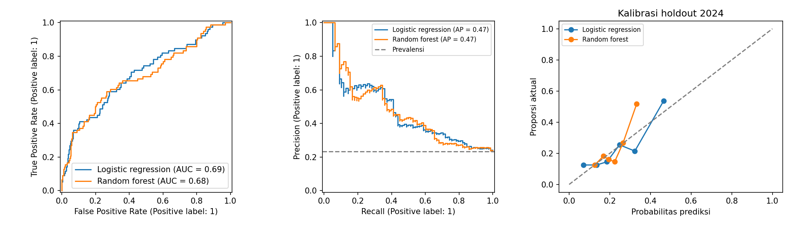
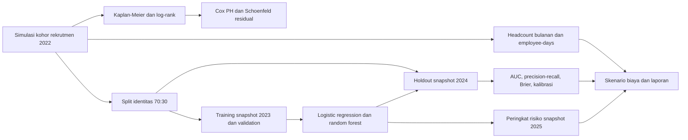
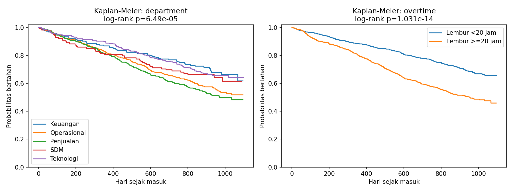

# HR Attrition Analytics

Saya menganalisis turnover, survival, dan risiko keluar 12 bulan pada kohor karyawan simulasi yang dapat direproduksi.




Saya menghubungkan metrik HR dengan survival analysis dan prediksi retensi pada data simulasi. Saya membandingkan dua model pada karyawan dan tahun yang berbeda, dengan AUC logistic regression 0.6915 serta random forest 0.6795. Saya menyajikan daftar risiko sebagai alat bantu diskusi retensi sukarela, bukan dasar pemutusan kerja.

## Latar belakang dan pertanyaan

Saya ingin mengetahui departemen mana yang memiliki turnover tertinggi, bagaimana lembur berkaitan dengan waktu bertahan, dan seberapa baik pengukuran baseline memprediksi exit 12 bulan. Saya juga memperkirakan biaya turnover berdasarkan asumsi eksplisit. Saya tidak mengklaim pernah menjalankan program retensi di perusahaan nyata.

## Data simulasi dan parameter pembangkit

Saya membangkitkan **1.500 karyawan sintetis**, seed **2024**, yang masuk sepanjang **2022** dan diamati sampai **31 Desember 2024**. Ini kohor rekrutmen, tanpa replacement hire pada 2023 atau 2024. Data di [employees_simulated.csv](data/employees_simulated.csv) tidak berisi catatan perusahaan atau individu nyata.

| Komponen | Parameter simulasi yang saya gunakan |
|---|---|
| Departemen | Operasional 35%, Penjualan 25%, Teknologi 20%, Keuangan 12%, SDM 8% |
| Level dan jabatan | Level 1/2/3/4 dengan peluang 35/35/23/7%; Staf, Analis, Supervisor, Manajer |
| Gaji bulanan | (Rp3,8 juta + level × Rp2,2 juta + Rp2 juta untuk Teknologi) × Lognormal(0; 0,12), dibulatkan Rp1.000 |
| Lembur | Normal(15 + 10 jika Operasional + 6 jika Penjualan; SD 9), dibatasi 0 sampai 60 jam/bulan |
| Engagement | Normal(3,8 − 0,018 × lembur; SD 0,65), dibatasi 1 sampai 5 |
| Jarak dan kenaikan gaji | Gamma(shape 2,2; scale 7 km), dibatasi 1 sampai 80 km; kenaikan Normal(5; SD 2)%, dibatasi 0 sampai 12% |
| Rating kinerja | 2/3/4/5 dengan peluang 10/45/35/10% |
| Usia, gender, status menikah | Usia Normal(25 + 4 × level; SD 5), dibatasi 20 sampai 60; gender dua kategori seimbang; menikah 55%. Saya tidak memakai ketiganya sebagai fitur keputusan |
| Tanggal promosi | Jadwal independen 180 sampai 799 hari setelah masuk pada 25% karyawan, hanya disimpan bila sebelum exit/censoring. Snapshot mengabaikan promosi yang belum terjadi |
| Tanggal kenaikan gaji | Tanggal masuk sebagai penyesuaian gaji awal. Saya menganggap gaji serta indikator baseline tetap selama follow-up, bukan riwayat penggajian bulanan |
| Manajer dan keluar | 60 ID manajer simulasi; alasan exit sukarela 84%, sisanya tidak sukarela, independen dari hazard |

Saya memakai hazard kumulatif Weibull `H(t) = 0,13 × exp(eta) × (t/365,25)^1,2`, dengan `eta = 0,028(lembur−20) − 0,6(engagement−3,5) + 0,012(jarak−15) − 0,08(kenaikan−5) + 0,28(Penjualan) + 0,16(Operasional) − 0,1(level−2)`. Waktu exit diperoleh lewat inverse transform. Koefisien itu adalah asumsi pembangkit, bukan estimasi dari perusahaan. Kode lengkap ada di [data.py](src/hr_attrition/data.py).

## Metodologi



Saya memakai jumlah exit dibagi rerata headcount **harian**, dengan employee-days / 365 atau 366 dan interval kerja `[masuk, keluar)`. Headcount akhir bulan adalah metrik tampilan terpisah. Turnover sukarela dan tidak sukarela memakai penyebut yang sama sehingga dapat dijumlahkan.

Saya memisahkan identitas karyawan sebelum membuat snapshot: training 1 Januari 2023 **n=970**, test 1 Januari 2024 **n=334**. Label mencakup exit selama 12 bulan berikutnya, hanya ketika follow-up lengkap. Tenure dihitung ulang pada snapshot, bukan memakai tenure final. Usia, gender, status menikah, ID manajer, ID karyawan, tanggal/alasan keluar tidak menjadi fitur keputusan. Preprocessing dipelajari hanya dari training.

Saya membagi training lagi 75:25 secara stratified untuk pemilihan model memakai average precision validation. Saya memilih **Random forest**, lalu melatih ulang pada seluruh training tanpa melihat test. Ambang confusion matrix **0,5** ditetapkan sebelumnya; saya tidak mengoptimalkan cutoff pada test. Peluang dari simulasi tidak otomatis terkalibrasi untuk perusahaan lain.

## Hasil utama

| Ukuran | Hasil eksekusi saya |
|---|---:|
| Karyawan keluar selama pengamatan | 588 |
| Aktif pada akhir pengamatan | 912 |
| AUC logistic regression, holdout 2024 | 0.6915 |
| AUC random forest, holdout 2024 | 0.6795 |
| Average precision logistic / random forest | 0.4720 / 0.4720 |
| Prevalensi exit holdout | 23.35% |
| Brier logistic / random forest | 0.1609 / 0.1662 |
| Departemen dengan turnover tertinggi pada 2024 | Penjualan, 29.85% |
| Ilustrasi penghematan penurunan exit relatif 20% di departemen tersebut | Rp614,888,400 |

Random forest terpilih dari validation AP (0.2952 vs 0.2930), meskipun logistic regression memiliki AUC test lebih tinggi. Pada cutoff 0,5, random forest tidak memprediksi exit sama sekali pada holdout. Karena itu saya menyajikan ranking dan probabilitas, serta tidak menganggap cutoff tersebut efektif untuk tindak lanjut. Skenario biaya mengasumsikan **6 bulan gaji per exit**, tanpa mengurangi biaya program retensi dan tanpa bukti dampak kausal.



Saya melaporkan log-rank departemen p=6.4897e-05, lembur p=1.0307e-14, serta diagnostik PH tiap kovariat. Tidak ada penolakan PH setelah Bonferroni pada eksekusi ini, tetapi hasil itu tidak membuktikan asumsi berlaku pada data nyata. Semua exit diperlakukan sebagai satu jenis event; hasil bukan cause-specific survival sukarela.

Saya menyimpan angka lengkap di [metrics.json](reports/metrics.json), [laporan analisis](reports/laporan_analisis.md), dan [notebook yang sudah dieksekusi](notebooks/01_hr_attrition.ipynb). Permutation importance menunjukkan perubahan AUC, sedangkan drivers per karyawan membandingkan probabilitas dengan median/modus training per fitur. Keduanya bersifat deskriptif, bukan sebab akibat.

## Struktur folder

```text
app/dashboard.py                  Dashboard Streamlit
src/hr_attrition/data.py           Generator, snapshot, turnover
src/hr_attrition/model.py          Split, model dan penjelasan risiko
src/hr_attrition/pipeline.py       Survival, evaluasi, figur, laporan, notebook
notebooks/01_hr_attrition.ipynb     Notebook teranotasi dan dieksekusi
reports/                          Metrik, tabel, prediksi dan laporan
assets/                           Grafik dari eksekusi pipeline
data/employees_simulated.csv      Data simulasi deterministik
tests/                            Tes batas tanggal, leakage dan rekonsiliasi
.github/workflows/ci.yml           Lint, tes, pipeline dan smoke test aplikasi
```

## Cara menjalankan

Saya memakai Python **3.12** dari root repo:

```bash
python -m venv .venv
source .venv/bin/activate
python -m pip install -r requirements.txt
make all
```

`make all` menjalankan lint, tes, lalu membangun ulang data, seluruh analisis, grafik, laporan dan notebook beserta outputnya. Saya menjalankan dashboard dengan:

```bash
streamlit run app/dashboard.py
```

Saya memilih departemen serta tahun untuk metrik dan melihat survival serta risiko karyawan aktif. Daftar risiko memakai snapshot **1 Januari 2025**, memproyeksikan 2025 yang belum diobservasi. Artefak model lokal dibangun ulang dan diabaikan Git; dashboard memakai tabel keluaran yang tersedia di repo.

### Demo

Tautan demo akan ditambahkan setelah deploy.

Saya menyiapkan path `app/dashboard.py` untuk Streamlit Community Cloud, branch `main`, Python 3.12, setelah PR digabungkan.

## Keterbatasan dan etika

- Saya memakai data simulasi dan kohor rekrutmen tanpa replacement hire, sehingga headcount menurun secara mekanis setelah 2022. Hasil bukan benchmark industri atau bukti pengalaman kerja.
- Saya menganggap pengukuran baseline tetap dan hanya memperbarui tenure serta informasi promosi yang diketahui pada snapshot. Evaluasi memakai satu pembagian karyawan dan satu transisi tahun, tanpa external validation atau interval ketidakpastian performa.
- Saya tidak menyebut penghapusan protected features sebagai bukti fairness. Gaji, jabatan, dan departemen masih bisa menjadi proxy. Data nyata memerlukan tinjauan fairness, tata kelola akses, dan persetujuan penggunaan.
- Saya memakai model sebagai alat bantu diskusi retensi sukarela. Risiko bukan alasan pemutusan kerja, sanksi, diskriminasi, atau keputusan otomatis terhadap individu.
- Saya memperlakukan semua exit sebagai event dan censoring administratif sebagai non-informatif. Efek program retensi belum diuji; skenario biaya bukan penghematan yang pernah dicapai.

## Lisensi

Saya menyediakan kode dan dokumentasi dengan [MIT License](LICENSE), atas nama Immantaka Juniarsa.

## Kontak

Saya **Immantaka Juniarsa**, S1 Statistika Universitas Airlangga (2024). GitHub [@imman20](https://github.com/imman20), email [immantakajuniarsa30@gmail.com](mailto:immantakajuniarsa30@gmail.com).
