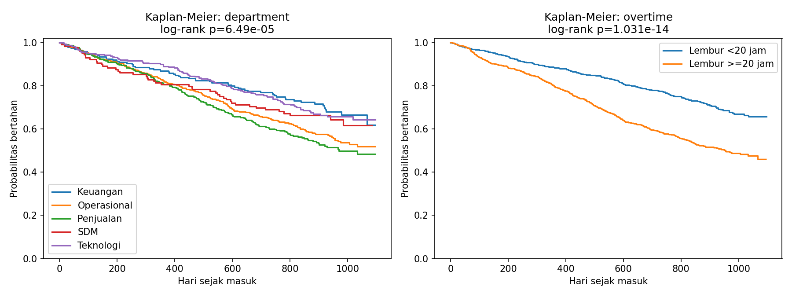
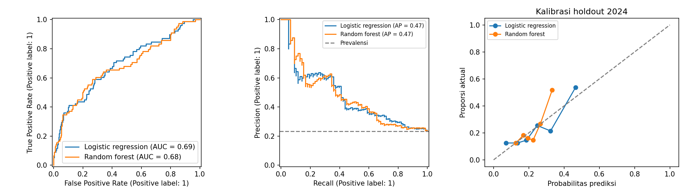

# Laporan analisis attrition: simulasi

Saya memakai seed 2024 untuk 1500 karyawan yang direkrut selama 2022 dan diamati sampai akhir 2024. Saya memperoleh 588 exit dan 912 karyawan aktif pada akhir pengamatan. Tidak ada data perusahaan nyata.

## Metrik HR

|   year | department   |   exits |   voluntary |   involuntary |   average_headcount |   turnover_rate |   voluntary_rate |   involuntary_rate |   mean_exit_tenure |
|-------:|:-------------|--------:|------------:|--------------:|--------------------:|----------------:|-----------------:|-------------------:|-------------------:|
|   2022 | Semua        |     123 |         103 |            20 |            717.3397 |          0.1715 |           0.1436 |             0.0279 |             0.3171 |
|   2023 | Semua        |     244 |         201 |            43 |           1256.4247 |          0.1942 |           0.1600 |             0.0342 |             1.0092 |
|   2024 | Semua        |     221 |         193 |            28 |           1013.9508 |          0.2180 |           0.1903 |             0.0276 |             1.9550 |

Saya memakai rerata headcount harian: employee-days / 365 atau 366, dengan interval kerja [tanggal masuk, tanggal keluar). Turnover sukarela dan tidak sukarela dijumlahkan menjadi total turnover. Headcount akhir bulan tersedia di monthly_headcount.csv dan rincian departemen di annual_turnover.csv. Rerata tenure hanya untuk karyawan yang keluar dan tidak sama dengan expected lifetime seluruh kohor.

## Survival

Saya memakai waktu sejak rekrutmen dengan right censoring administratif akhir 2024. Tidak ada left truncation karena seluruh tanggal masuk tercakup observasi. Semua exit adalah event, sehingga ini bukan model cause-specific sukarela. Log-rank departemen p=6.4897e-05; lembur p=1.0307e-14. Concordance Cox in-sample=0.6779, bukan ukuran generalisasi.

Tes PH Schoenfeld rank menghasilkan p terkecil 0.24418, dengan 0 penolakan setelah koreksi Bonferroni. Saya menyajikan setiap p-value di cox_ph_diagnostics.csv. Jika asumsi ditolak, satu hazard ratio konstan harus dibaca hati-hati dan model time-varying atau stratifikasi perlu diuji sebelum penggunaan. Koefisien, hazard ratio, CI dan p-value tersedia di cox_coefficients.csv.

## Prediksi keluar 12 bulan

Saya memisahkan identitas dengan rasio 70:30, membangun snapshot training 1 Januari 2023 (n=970) dan test 1 Januari 2024 (n=334). Karyawan yang sudah keluar dikeluarkan sebelum snapshot. Training dibagi lagi 75:25 secara stratified untuk memilih model dari average precision validation. Saya memilih Random forest, lalu melatih ulang pada seluruh training. Test hanya dipakai untuk pelaporan. Ambang confusion matrix 0,5 ditetapkan sebelumnya.

|                     |    auc |   average_precision |   brier |   prevalence |   validation_ap |
|:--------------------|-------:|--------------------:|--------:|-------------:|----------------:|
| Logistic regression | 0.6915 |              0.4720 |  0.1609 |       0.2335 |          0.2930 |
| Random forest       | 0.6795 |              0.4720 |  0.1662 |       0.2335 |          0.2952 |

Saya membandingkan average precision terhadap prevalensi pada test. Brier score mengukur galat probabilitas; kurva kuantil menunjukkan kalibrasi tanpa melakukan calibration fitting di test. Feature engineering tenure memakai tanggal snapshot, promosi mendatang diabaikan. Usia, gender, status menikah, ID, tanggal/alasan keluar dan tenure final tidak menjadi fitur. Departemen dan gaji masih dapat menjadi proxy sehingga pengecualian protected features tidak membuktikan fairness.

Confusion matrix [TN, FP; FN, TP]: {"Logistic regression": [[248, 8], [66, 12]], "Random forest": [[256, 0], [78, 0]]}. Permutation importance tersedia di permutation_importance.csv; saya melaporkan penurunan AUC pada holdout, bukan sebab akibat. Korelasi antarf fitur membatasi interpretasi.

## Daftar risiko dan etika

Saya memberi peringkat karyawan aktif pada 1 Januari 2025 dengan model terpilih tanpa melatih ulang memakai test. Risiko itu memproyeksikan 2025 yang belum diobservasi, sehingga belum ada validasi aktual untuk daftar tersebut. Drivers menunjukkan perubahan probabilitas terhadap median/modus training per fitur secara terpisah, bukan SHAP atau efek intervensi. Semua ID adalah simulasi. Saya memakai daftar untuk diskusi retensi sukarela dan perbaikan kondisi kerja, bukan dasar pemutusan kerja, sanksi, atau penilaian individu.

## Simulasi biaya

Saya mengasumsikan biaya setiap exit sebesar 6 bulan gaji, tanpa membedakan sukarela/tidak sukarela. Estimasi seluruh periode Rp30,460,236,000; pada 2024 Rp11,502,582,000. Departemen dengan turnover 2024 tertinggi adalah Penjualan (29.85%, 65 exit). Jika frekuensi exit departemen ini berkurang relatif 20% dengan gaji keluar rata-rata tetap, penghematan ilustratif Rp614,888,400. Ini asumsi aritmetika, bukan dampak kausal atau penghematan yang pernah dicapai. Biaya program retensi belum dikurangkan.

## Keterbatasan

Saya mensimulasikan kohor rekrutmen, tanpa replacement hire setelah 2022. Gaji dan indikator perilaku adalah pengukuran baseline yang dianggap tetap, sehingga tidak merepresentasikan riwayat HR bulanan sesungguhnya. Evaluasi hanya satu pembagian identitas dan satu transisi tahun, tanpa external validation. Confidence interval performa belum dihitung. Sebelum penggunaan nyata diperlukan persetujuan pekerja, tinjauan proxy fairness, validasi prospektif dan tata kelola akses.
